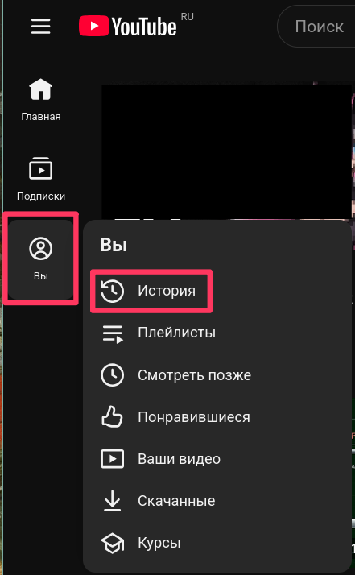
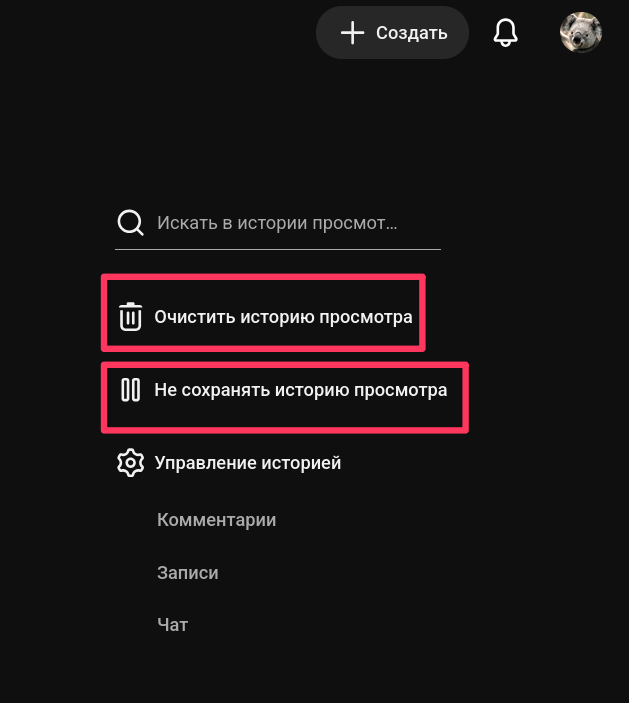
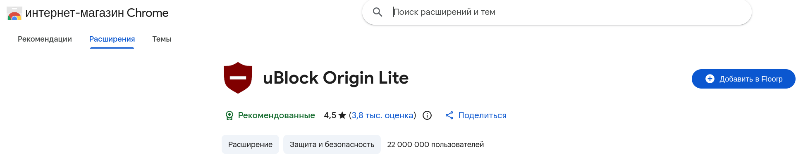
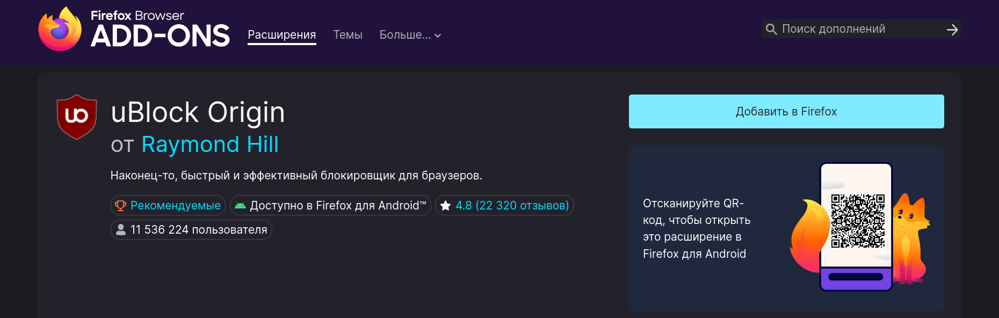

# Вырезание Shorts и затягивающих лент из YouTube с помощью uBlock


Набор пользовательских фильтров для полного удаления Shorts из YouTube.   
Решение работает на уровне браузера, не требует сторонних приложений.

---
## Что делает набор

- Полностью скрывает блок Shorts с главной страницы YouTube.
- Удаляет кнопку Shorts из бокового меню навигации.
- Блокирует превью Shorts в результатах поиска и правой колонке рекомендаций.
- Ломает механизм бесконечного свайпа при переходе по прямой ссылке (интерфейс плеера Shorts скрывается).
- Не затрагивает домены `googlevideo.com` и основной API плеера — совместимо с ByeDPI и другими DPI-обходчиками.

---
## Требования
### На ПК подходит любой браузер.
### На телефоне необходим браузер, поддерживающий расширения: 
##### На базе Chromium: 
- Microsoft Edge, Samsung Internet, Яндекс Браузер.
##### На базе Firefox:
- Firefox, WebLibre, Fennec, IronFox, Iceraven, Waterfox, Tor Browser

| OS | Chromium-based | Gecko-based |
|---|---|---|
| **Windows** | Любой браузер | Любой браузер |
| **Android** | Microsoft Edge, Samsung Internet, Яндекс Браузер | Firefox, WebLibre, Fennec, IronFox, Iceraven, Waterfox, Tor Browser |


> На пк практически каждый браузер имеет поддержку расширений, поэтому округлено до любого.

> Как оно там на устройствах яблок, понятия не имею. На Linux всё аналогично с Windows.

> uBlock Origin Lite (версия для Chrome Web Store после перехода на Manifest V3) поддерживает только базовые фильтры. Для полной функциональности рекомендуется классический uBlock Origin, доступный для бразеров на базе Firefox.

---

## Установка

### Шаг 0. Удаление истории просмотров

|  |  |
|:---:|:---:|
| **Шаг 1. «Вы» → «История»** | **Шаг 2. «Очистить» и «Не сохранять»** |

> Необходимо для отключения функции рекомендаций видео. После этого на главном экране больше не будет ленты.


### Шаг 1. 
- Установка uBlock
В завимости от ядра вашего браузера, установка осуществляется из магазина расширений [Chrome](https://chromewebstore.google.com/detail/ublock-origin-lite/ddkjiahejlhfcafbddmgiahcphecmpfh?hl=ru) или [Firefox](https://addons.mozilla.org/ru/firefox/addon/ublock-origin/) 

|  |  |
|:---:|:---:|
| **В браузерах на базе Chromium** | **В браузерах на базе Firefox** |

### Шаг 2.  

---

## Содержимое filters.txt

Ниже — актуальная версия набора фильтров. Блок кода ниже автоматически имеет кнопку копирования в правом верхнем углу на странице GitHub.
```code
||youtube.com/youtubei/v1/reel/$xhr
||youtube.com/s/player/*/shorts_$script
||youtube.com/s/desktop/*/shorts_$script
www.youtube.com##ytd-rich-section-renderer
www.youtube.com##ytd-reel-shelf-renderer
www.youtube.com##ytd-shorts
www.youtube.com##ytd-reel-item-renderer
www.youtube.com##ytd-rich-item-renderer:has(a[href*="/shorts/"])
www.youtube.com##ytd-grid-video-renderer:has(a[href*="/shorts/"])
www.youtube.com##ytd-video-renderer:has(a[href*="/shorts/"])
www.youtube.com##ytd-compact-video-renderer:has(a[href*="/shorts/"])
www.youtube.com##ytd-rich-item-renderer:has(span:has-text(Shorts))
www.youtube.com##ytd-rich-item-renderer:has(span:has-text(Шортсы))
www.youtube.com##ytd-guide-entry-renderer:has-text(Shorts)
www.youtube.com##ytd-guide-entry-renderer:has-text(Шортсы)
www.youtube.com##ytd-guide-entry-renderer[title="Shorts"]
www.youtube.com##ytd-guide-entry-renderer[title="Шортсы"]
m.youtube.com##ytd-rich-section-renderer
m.youtube.com##ytd-reel-shelf-renderer
m.youtube.com##ytd-shorts
m.youtube.com##ytd-reel-item-renderer
m.youtube.com##ytd-rich-item-renderer:has(a[href*="/shorts/"])
m.youtube.com##ytd-compact-video-renderer:has(a[href*="/shorts/"])
m.youtube.com##ytm-reel-shelf-renderer
m.youtube.com##ytm-shorts
m.youtube.com##ytm-pivot-bar-item-renderer:has-text(Shorts)
m.youtube.com##ytm-pivot-bar-item-renderer:has-text(Шортсы)
m.youtube.com##a[href*="/shorts/"]
www.youtube.com##ytd-watch-next-secondary-results-renderer
www.youtube.com##ytd-secondary
m.youtube.com##ytd-watch-next-secondary-results-renderer
m.youtube.com##.full-bleed-wn-thumbs.watch-content > .single-column-watch-next-modern-panels.scwnr-content > lazy-list
www.youtube.com##ytd-mini-guide-entry-renderer.ytd-mini-guide-renderer.style-scope:nth-of-type(2)
```
